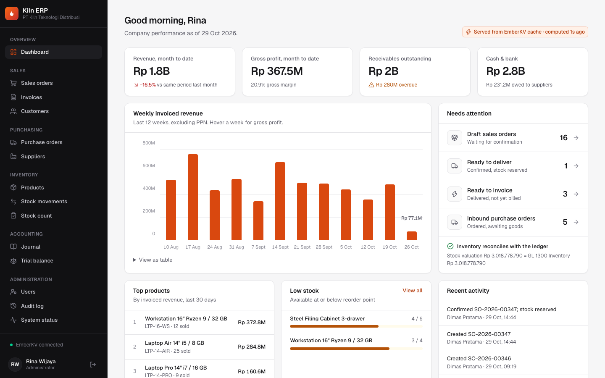
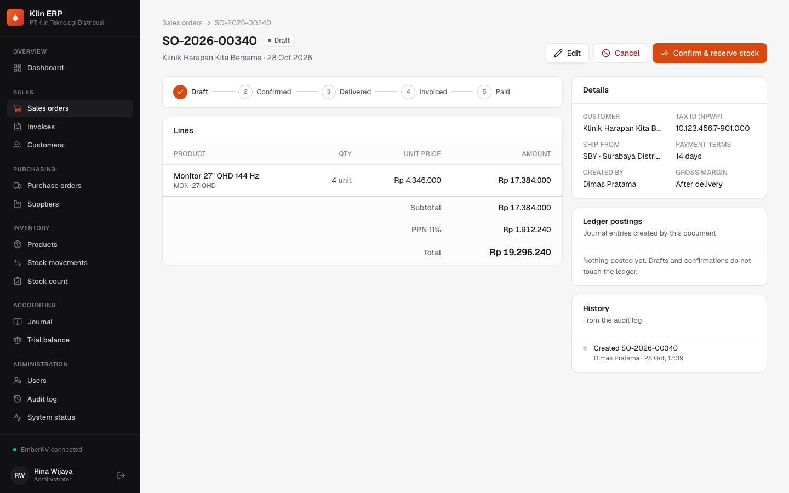
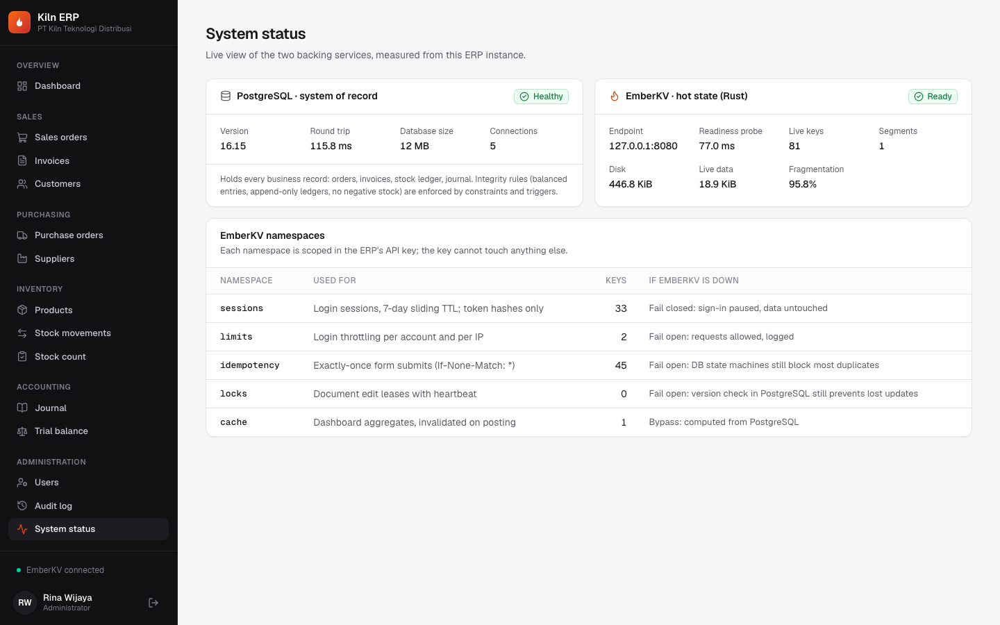
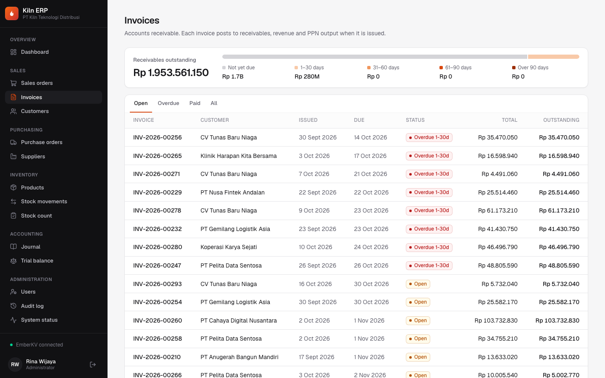
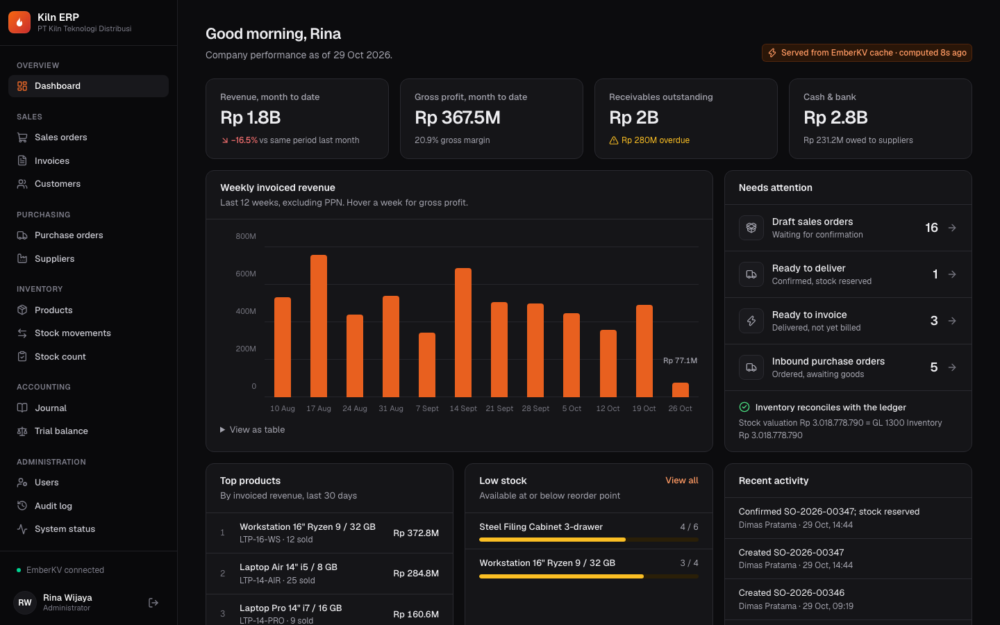

# Kiln ERP

[](https://github.com/dimasmuly/kiln-erp/actions/workflows/ci.yml)

**A full-stack ERP for a distribution company, built on Next.js 16 and PostgreSQL. Its hot state runs on [EmberKV](https://github.com/dimasmuly/emberkv), a key-value store I wrote in Rust.**

Kiln covers sales orders through invoicing and cash collection, purchasing through supplier payment, a perpetual inventory with weighted-average costing, and a double-entry general ledger. Every business event posts a balanced journal entry. Correctness rules are enforced by PostgreSQL itself, so they hold no matter which code path writes the data: debits equal credits, stock never goes negative, and ledgers are append-only.

The ERP is also the production client of EmberKV. Sessions, login throttling, exactly-once form submission, document edit locks and the dashboard cache all go through EmberKV's TypeScript SDK. Each of these features has a designed failure mode for when EmberKV is down.



<table>
  <tr>
    <td></td>
    <td></td>
  </tr>
  <tr>
    <td></td>
    <td></td>
  </tr>
</table>

## Architecture

```text
 Browser ──HTTPS──▶ Next.js 16 (App Router, Server Components, Server Actions)
                    │
                    │  proxy.ts            optimistic cookie check
                    │  Server Actions      validate → authorize → idempotency → command
                    │  Data Access Layer   requireUser() · RBAC in every service
                    │
                    ├── domain/            pure TypeScript, shared by browser and server
                    │   money · pricing & PPN · weighted-average costing · posting rules · state machines
                    │
                    ├── server/modules/    commands (one DB transaction each) and queries
                    │        │
                    │        ▼
                    │   PostgreSQL 16  ── system of record
                    │     orders, invoices, payments, stock ledger, journal, audit log
                    │     CHECK constraints · deferred balance trigger · append-only triggers
                    │
                    └── server/kv/ ──HTTP + Bearer──▶ EmberKV (Rust, ../emberkv)
                          sessions · limits · idempotency · locks · cache
                          one API key, scoped to exactly these five namespaces
```

Two repositories, two languages, one product. The ERP consumes EmberKV the way a real team would consume an internal platform service: over its public HTTP API, through its published SDK, with a scoped API key. It never links against the Rust code.

## What EmberKV does for the ERP

| Feature | EmberKV primitive | Why it's there | If EmberKV is down |
|---|---|---|---|
| **Sessions** | `PUT ?ttl=7d`, prefix scan, batch delete | Fast lookup on every request. The cookie holds `userId.token`; EmberKV stores only `sha256(token)`, so leaked logs or backups contain no usable credentials. Deactivating a user revokes every device at once. | **Fail closed.** A clear "temporarily unavailable" page; nobody is let in or logged out. |
| **Login throttling** | `rate-limits` (atomic fixed window) | 5 attempts per account and 30 per IP every 15 minutes. Emails and IPs are hashed before they become keys. | **Fail open**, logged. Throttling is lost for a while, which is better than locking out the whole company. |
| **Exactly-once submits** | `If-None-Match: *` (create-only) + TTL | Every form carries a server-minted key. A double click or a retried request on bad Wi-Fi replays the first result instead of creating a second order or recording a payment twice. | **Fail open.** The row locks and state machines in PostgreSQL still reject most duplicates. |
| **Edit leases** | create-only + TTL, renewed with `If-Match` | "Dimas is editing SO-2026-00042". A 20 s heartbeat keeps the lease; a closed tab releases it via `sendBeacon`; a crashed browser just lets it expire. | **Fail open.** Optimistic `version` checks in PostgreSQL still prevent lost updates. |
| **Dashboard cache** | `GET` / `PUT ?ttl=60s`, batch delete | KPIs are shared by every ERP instance and invalidated by each command that posts to the ledger. | **Bypass.** Computed from PostgreSQL. |

Business records never go to EmberKV. Invoice numbers, for example, come from a sequence table in PostgreSQL, even though an EmberKV counter would be faster: auditors expect invoice numbers without gaps, and only a sequence that lives inside the business transaction can guarantee that. See [ADR-0002](docs/adr/0002-emberkv-boundary.md).

## Engineering highlights

- **The ledger balances by construction, then PostgreSQL checks it again.** Posting rules are pure functions (`goodsReceipt`, `delivery`, `salesInvoice`…) that return balanced lines, and they are unit-tested. A `DEFERRABLE INITIALLY DEFERRED` constraint trigger rejects any transaction that would commit an unbalanced entry, whether it comes from the app, a script or `psql`. [ADR-0004](docs/adr/0004-database-enforced-ledger.md)
- **The inventory sub-ledger reconciles with the GL to the sen, forever.** Costing tracks the *total value* per product rather than a rounded unit cost. Each issue removes `value × qty / onHand`, rounded once, and the last unit removes exactly what is left. The dashboard checks `Σ stock value = GL 1300` live. [ADR-0003](docs/adr/0003-money-and-costing.md)
- **No overselling under concurrency.** A reservation is a single conditional `UPDATE … WHERE on_hand - reserved >= qty`, with `CHECK (reserved <= on_hand)` as the last line of defense. A test fires 20 simultaneous confirmations at 10 units of stock and asserts that exactly 10 succeed.
- **No deadlocks.** Commands follow one documented lock order: document row first, then product rows in ascending id order. Tested with orders whose lines are deliberately listed in opposite orders. [ADR-0005](docs/adr/0005-concurrency.md)
- **Segregation of duties.** Sales creates and confirms orders, Warehouse ships them, Finance invoices and collects. Permissions are checked in the service layer, so a forged Server Action request is refused the same way the UI hides the button.
- **Exact money.** All amounts are integer minor units (sen), and rounding happens in one `BigInt`-backed helper. PPN is computed on the document subtotal, as on a real *faktur pajak*.
- **Append-only history.** Journal lines, stock movements and payments reject `UPDATE`/`DELETE` at the database level. Corrections are new entries. The audit log is written in the same transaction as the change it describes.
- **Next.js 16 done properly.** The app uses Cache Components with partial prerendering, so every route ships a static shell and the session-dependent data streams behind Suspense. Server Actions return typed results and never raw errors; unknown failures are logged with a reference id. `proxy.ts` does only the cheap cookie check. Pricing logic is shared: the order editor computes totals with the same `priceOrder` function the server uses.

## Tech stack

| Layer | Choice |
|---|---|
| App | Next.js 16 (App Router, Turbopack, Cache Components), React 19, TypeScript strict |
| UI | Tailwind CSS 4 with semantic design tokens (light and dark), lucide icons, accessible charts with a table view |
| Data | PostgreSQL 16, Drizzle ORM, SQL migrations with hand-written integrity triggers |
| Hot state | EmberKV (Rust) via `@emberkv/client`, consumed from source in the sibling repo |
| Validation | Zod 4 at the service boundary |
| Auth | scrypt password hashes, server-side sessions, role-based permissions |
| Tests | Vitest (unit and integration against real PostgreSQL and EmberKV), Playwright (end-to-end) |
| Ops | Docker Compose, `/api/health` readiness probe, JSON logs, GitHub Actions |

## Quick start

Clone both repositories side by side. The ERP builds and consumes EmberKV from `../emberkv`:

```text
workspace/
├── emberkv/   ← Rust key-value store
└── erp/       ← this repo
```

```bash
cd erp
npm install
./scripts/emberkv-setup.sh            # mint scoped EmberKV API keys → .dev/ and .env.local
docker compose up -d postgres emberkv # or: npm run emberkv (native, needs cargo)
npm run db:seed                       # migrate + simulate 120 days of trading
npm run dev                           # http://localhost:3000
```

Sign in with any demo account (password `kiln-demo-2026`). The login page has one-click buttons for each role:

| Account | Role | Can |
|---|---|---|
| `admin@kiln.test` | Administrator | Everything, including users and system status |
| `sales@kiln.test` | Sales | Create and confirm orders, manage customers |
| `warehouse@kiln.test` | Warehouse | Deliver orders, receive goods, count stock |
| `finance@kiln.test` | Finance | Issue invoices, record payments, view the ledger |
| `purchasing@kiln.test` | Purchasing | Create and send purchase orders |

To run the whole stack in containers: `docker compose --profile full up -d --build`.

The seed does not insert rows directly. It **runs the real commands**: it receives purchase orders, confirms and ships sales orders, issues invoices, collects partial and late payments and records stock counts, all with backdated contexts. So the demo data obeys every invariant that production data does.

## Testing

```bash
npm test                    # 51 unit tests: money, pricing, costing, posting rules, workflows, RBAC
npm run test:integration    # 20 tests against real PostgreSQL + EmberKV
npm run test:e2e            # Playwright: order-to-cash across three roles, edit lock with two browsers
npm run check               # lint + typecheck + unit tests
```

| Suite | What it proves |
|---|---|
| [`inventory.test.ts`](tests/unit/inventory.test.ts) | 200 random receipt/issue histories: value never drifts, never goes negative, and is exactly zero once everything is issued |
| [`posting.test.ts`](tests/unit/posting.test.ts) | Every posting rule balances; unbalanced or two-sided lines are refused |
| [`order-to-cash.test.ts`](tests/integration/order-to-cash.test.ts) | Full procure-to-pay and order-to-cash; every sub-ledger reconciles with the GL; the database itself rejects unbalanced entries, history rewrites and over-reservation |
| [`concurrency.test.ts`](tests/integration/concurrency.test.ts) | 20 parallel confirmations for 10 units; opposite lock orders without deadlock; a double-clicked Deliver posts once; parallel partial payments never exceed the invoice |
| [`emberkv.test.ts`](tests/integration/emberkv.test.ts) | Sessions (including forged cookies), idempotent replay, leases, rate limits, cache, and the designed behavior **when EmberKV is unreachable** |
| [`order-to-cash.spec.ts`](tests/e2e/order-to-cash.spec.ts) | A real browser runs Sales → Warehouse → Finance and checks that every role sees only its own buttons; a second editor is locked out until the first one leaves |

## Project structure

```text
src/
├── app/                 Next.js routes: (app)/ authenticated shell, login, api/health
├── components/          UI primitives (ui/), order editor, chart, toasts, lease guard
├── domain/              pure business rules: no I/O, shared by client and server
└── server/
    ├── actions/         Server Actions: form → validated command → typed result
    ├── auth/            sessions (EmberKV), scrypt passwords, RBAC
    ├── db/              Drizzle schema and pooled client
    ├── kv/              every EmberKV integration, each with its fallback
    └── modules/         sales, purchasing, inventory, accounting, dashboard, admin
drizzle/                 SQL migrations (0001 = integrity triggers)
scripts/                 migrate, seed (120-day simulation), EmberKV key setup
tests/                   unit/, integration/, e2e/
docs/                    ARCHITECTURE.md, adr/, screenshots/
```

## Design decisions

| ADR | Decision |
|---|---|
| [0001](docs/adr/0001-nextjs-cache-components.md) | Next.js 16 App Router with Cache Components; Server Actions as the only write path |
| [0002](docs/adr/0002-emberkv-boundary.md) | What lives in EmberKV versus PostgreSQL, and why gap-free numbers stay in PostgreSQL |
| [0003](docs/adr/0003-money-and-costing.md) | Integer minor units; weighted-average costing tracked as total value |
| [0004](docs/adr/0004-database-enforced-ledger.md) | Balanced entries and append-only ledgers enforced by PostgreSQL triggers |
| [0005](docs/adr/0005-concurrency.md) | Row locks, a global lock order, conditional reservations, versions plus leases |
| [0006](docs/adr/0006-failure-modes.md) | Per-feature fail-open / fail-closed behavior when EmberKV is unavailable |

More detail in [docs/ARCHITECTURE.md](docs/ARCHITECTURE.md).

## Limitations & roadmap

These are deliberate scope cuts for a portfolio project, listed so the trade-offs are visible:

- [ ] Partial deliveries and partial receipts (today a document ships or arrives in full)
- [ ] Multi-currency and period closing (today: IDR only, no closed periods)
- [ ] Credit notes and reversing journal entries from the UI (the ledger already supports them; the screens don't exist yet)
- [ ] Stock transfers between warehouses
- [ ] A Content Security Policy with nonces
- [ ] e-Faktur export for the Indonesian tax office

## License

MIT
